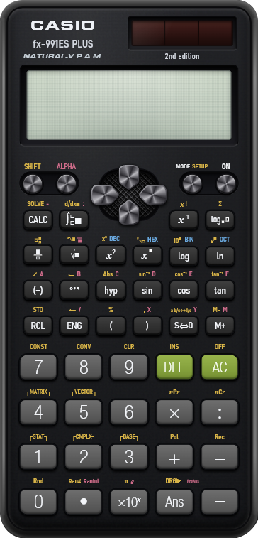

# CASIO FX-991ES PLUS Simulator

Windows simulator of the CASIO fx-991ES PLUS (2nd Edition).

This is a simulation, not an emulator. It contains no ROM or firmware; the calculator functions were written in code. You must own the physical calculator to use it.

## Requirements

- Windows 10 or 11
- WebView2 Runtime
